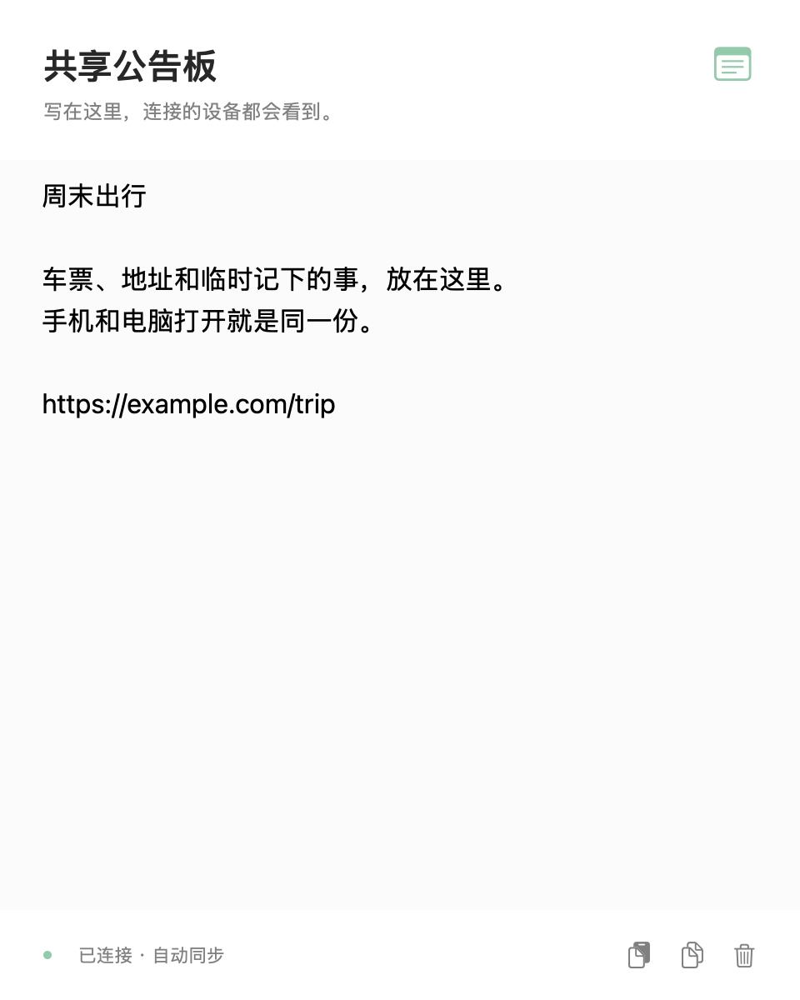

# MiDrop 0.4

无需账号的 Mac ↔ 小米 / Android 局域网文件分享与共享公告板。Mac 常驻菜单栏，文字与链接连接后自动同步；首次在 Mac 点一次允许，之后自动重连。


## 获取源码

```bash
git clone https://github.com/dustkxx/MiDrop.git ~/Codes/MiDrop
cd ~/Codes/MiDrop
```

仓库包含源码、图标与测试记录。SDK、模拟器、签名密钥、配对凭据和 `dist/` 构建产物均不提交；构建方法见下文。首次自行构建 Android 时会生成本机签名密钥；后续升级需使用同一密钥。

## 安装与升级

- Mac 和 Android 当前版本均为 **0.4.0**（Mac build 7，Android versionCode 6）：文字改为同一份共享公告板，编辑后自动同步，无发送按钮、收件设备或消息历史。
- Mac：打开 `dist/MiDrop.app`，菜单栏会出现新的双弧标识。点击它展开小面板。
- 手机：安装 `dist/MiDrop-android.apk`，覆盖原版即可。**不需要卸载，也不要清除应用数据。**
- 原有证书、配对凭据和 Android 签名密钥已保留。新连接流程和双向传输需要两端都更新到 0.2。
- 共享公告板需要两端均更新至 0.4.0；可直接覆盖安装，无需重新配对。旧版仍可传文件。
- 本机 Mac 构建依赖 Command Line Tools 提供的 `/usr/bin/python3`。当前产物为本机签名版本，未做 Developer ID 公证。

## 第一次连接

1. 两台设备连接同一 Wi-Fi / 局域网，打开 Mac 菜单栏 MiDrop。
2. 手机打开 MiDrop，进入「文件」页，点击发现的 Mac 完成首次连接。
3. Mac 小面板出现手机请求，点击 **允许并记住**。不需要输入配对码。
4. 手机可按提示允许通知，查看接收进度和完成提示；在设置中可暂停后台接收。

已连接过的手机升级后会继续使用原凭据。证书或设备信任被清除时，需要重新允许连接。

## 手机发送到 Mac

在相册或文件管理器选择文件 → 分享 → **MiDrop** → 点击已信任的 Mac 卡片。

也可以在手机 MiDrop 的「文件」页点「选择文件」。文件默认保存到 Mac 的 `~/Downloads/MiDrop`。

## Mac 发送到手机

在 Finder 中选择一个或多个文件 → **右键 → 共享 → MiDrop**，在打开的发送窗口选择手机，点击 **发送到手机**。MiDrop 未运行时会自动启动；手机离线时文件会留在待发送列表，连接后可发送。首次安装如果没有显示 MiDrop，请在共享菜单的「编辑扩展…」中启用。

也可以在菜单栏 MiDrop 小面板选择在线手机，拖入文件，或点击拖入区域选择文件。已配对且连接中的手机会自动接收，前台和后台都无需逐次确认；多个批次依次接收。传输中仍可取消。

后台接收默认开启。关闭后，仅在手机打开 MiDrop 时接收；手机离线、后台接收暂停或旧版 Android 缺少保存权限时，Mac 不会发起新传输。通知权限影响提示显示，不影响连接中的自动接收。两分钟内未被接收端接手的批次仍会过期。

手机保存位置为 **Download/MiDrop**，可在系统文件管理器查看，也可从 MiDrop 设置打开最近收到的文件。

## 共享公告板

- Mac 菜单栏点「共享公告板」；手机默认打开「公告板」页。两端编辑的是同一份文字，无需选择设备、点击发送或查看消息记录。
- 输入停顿约 0.6 秒自动同步，所有连接到这台 Mac 的已配对手机都能看到最新内容；清空也会同步。手机后台保持连接时同样更新，通知权限不影响同步。
- 可直接粘贴、复制整份内容。整段内容为 HTTP/HTTPS 链接时提供打开入口，不自动覆盖剪贴板或打开网页。其他应用的「共享 → MiDrop」文字/链接会写入公告板并自动同步。
- 只有当前公告板，没有历史列表，不生成 `.txt`。旧文字记录不展示，也不自动导入公告板或广播给其他设备。
- 两端会保存未同步草稿；断线重连后同步。如果另一端已更新，较旧草稿不会覆盖它：可选择「使用另一端内容」，或继续编辑本机草稿后自动同步。
- 保留中文、emoji、空格和换行；整份内容最多 64 KiB（UTF-8）。公告板及本地草稿保存在应用私有数据中，沿用配对和 HTTPS 证书固定校验，不经过云端。



## 界面与设置

Mac 小面板保留设备、文件传输和公告板入口；手机用「公告板 / 文件」切换。地址、指纹、取消设备信任和日志入口都在 Mac 齿轮设置中；Android 右上角「•••」打开设置。

Mac 关闭小面板后仍在后台接收；在底部菜单选择「退出 MiDrop」才会停止。Android 的后台接收依赖系统前台服务，关闭 App 页面后可继续等待请求，但系统强制停止应用会中断连接。

Mac 同一用户只运行一个 MiDrop 实例；从其他路径打开新版副本时，会唤起当前实例，并转交共享内容后自动退出。

通知权限、通知渠道、勿扰模式及小米系统的后台限制会影响提示。后台提示使用系统通知，不强制拉起全屏窗口，也不申请悬浮窗权限。若手机不可接收，Mac 会显示接收暂停或离线；停止进程后最长约一分钟更新离线状态。

## 传输行为

- 本地 HTTPS 加密，首次由 Mac 人工允许建立信任，后续固定完整证书指纹。
- 保留原文件字节，单文件上限 20 GiB。支持多文件、中文文件名和空文件。
- SHA-256 校验通过才发布文件；失败或取消会清理未完成内容。
- 重名文件另存副本，保留已有内容。失败重试从头开始，已成功的文件可能产生重名副本。
- Android 10+ 使用 MediaStore 保存到 Download/MiDrop，无需全部文件访问权限；Android 8–9 需要单独允许保存权限。
- 当前手机保存一台 Mac 的信任，Mac 可信任多台手机。仅支持局域网 IPv4，不支持互联网中转或断点续传。
- Wi-Fi 访客隔离或防火墙可能阻止连接。手动地址入口只用于自动发现失败，不能绕过网络隔离。

## 构建

```bash
cd ~/Codes/MiDrop

# 矢量母版 → Mac icns 与 Android 图标（更改图标时执行）
bash scripts/build-icons.sh

# Mac
bash scripts/build-mac.sh

# Android：本机已验证的独立 SDK 构建，无需 Gradle / Android Studio
JAVA_HOME=/opt/homebrew/opt/openjdk/libexec/openjdk.jdk/Contents/Home bash scripts/build-android-sdk.sh
```

Android SDK 位于项目 `.sdk/`；保留 `.tools/debug.keystore`，后续 APK 才能直接覆盖安装。另提供 `android/` Gradle 项目，版本号与直接构建保持同步；本轮实际验证的是独立 SDK 构建路径。

下载工具支持进程级代理或指定 Google 域名解析，不修改系统网络设置：

```bash
python3 scripts/download-sdk.py --proxy http://127.0.0.1:7890
# 或使用 dl.google.com 当前有效的 IPv4 独立直连
python3 scripts/download-sdk.py --google-ip <当前有效IPv4>
```

## 验证与预览

协议集成测试：

```bash
PYTHONPYCACHEPREFIX=/private/tmp/midrop-pycache python3 -m unittest discover -s tests -v
```

`previews/` 提供 Mac 明暗主题原生界面渲染及 Android 实际测试截图；具体结果与待验证项目见 `docs/VALIDATION.md`。图标母版为 `assets/logo.svg`。

Mac 状态监听测试：`bash scripts/test-mac-state-monitor.sh`。`previews/mac-idle-cpu-report.json` 记录同机空闲 CPU 对比；短时间采样不代表长期平均能耗。

Mac 共享扩展检查：先打开构建后的 App 并启用 MiDrop 共享扩展，再运行 `bash scripts/test-mac-share.sh`。该检查覆盖激活规则，以及系统对文件、文字和网页链接的共享入口识别；实际 Finder 点击流程见验证记录。

公告板检查：`bash scripts/test-mac-board.sh` 验证 Mac 真实编辑模型与隔离后端。启动独立 `MiDrop-QA` 模拟器（端口 5556），构建独立测试 APK 后运行 `python3 scripts/emulator-text-smoke.py`，覆盖真实编辑框自动同步、复制、系统分享、后台更新、离线冲突和同步清空，不操作真实手机。

`docs/PROTOCOL.md` 记录 API 与本机控制边界。源码结构为 `mac/`、`android/app/`、`assets/`、`scripts/` 和 `tests/`。
